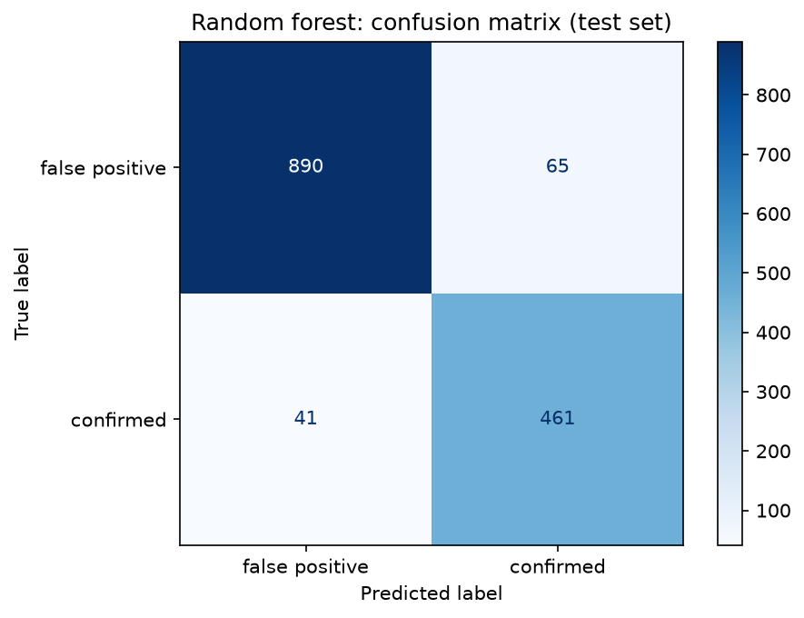
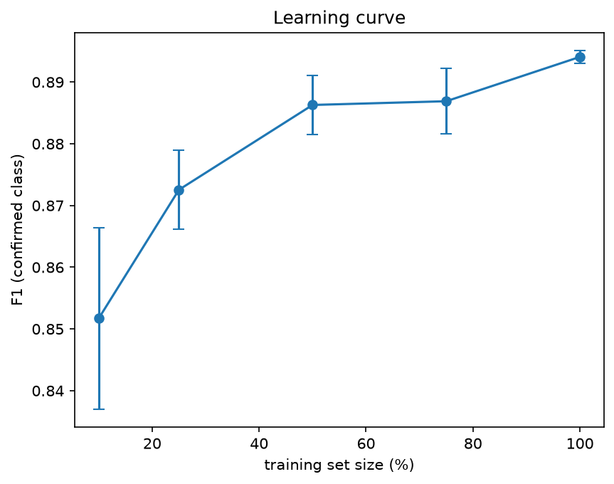
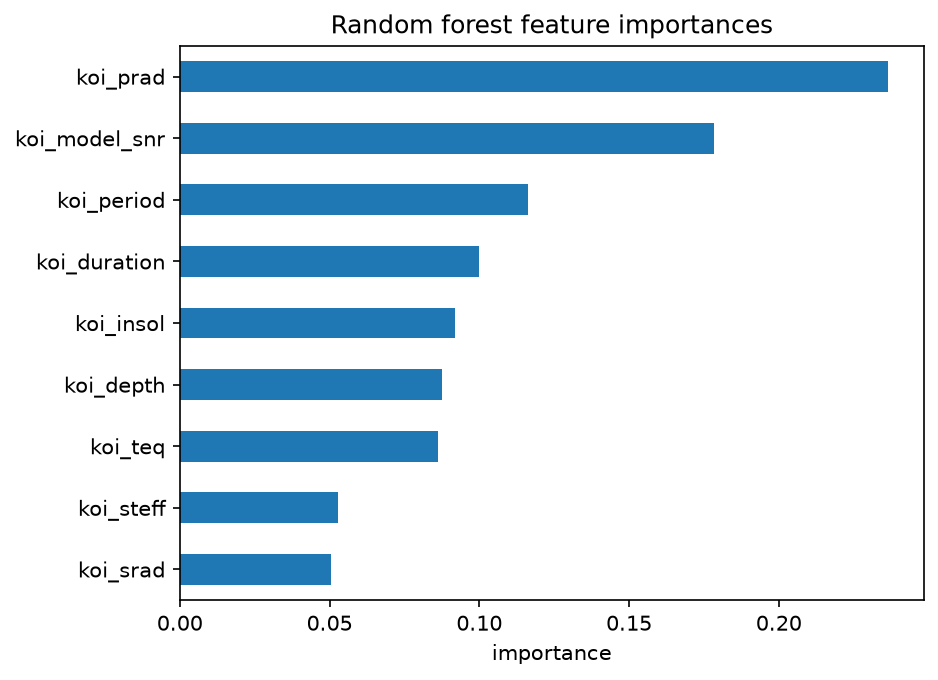
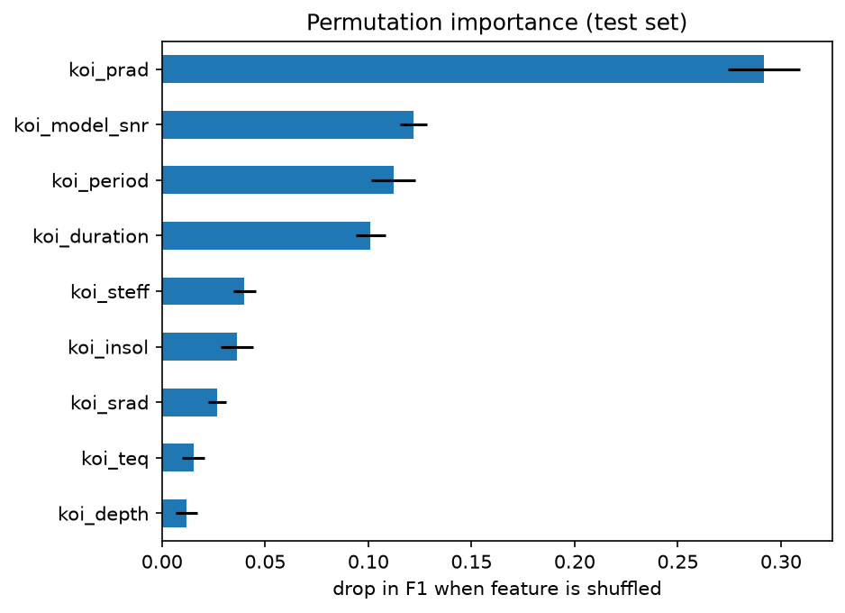
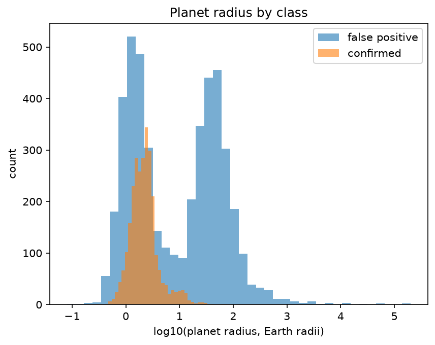
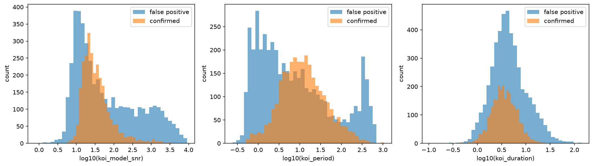
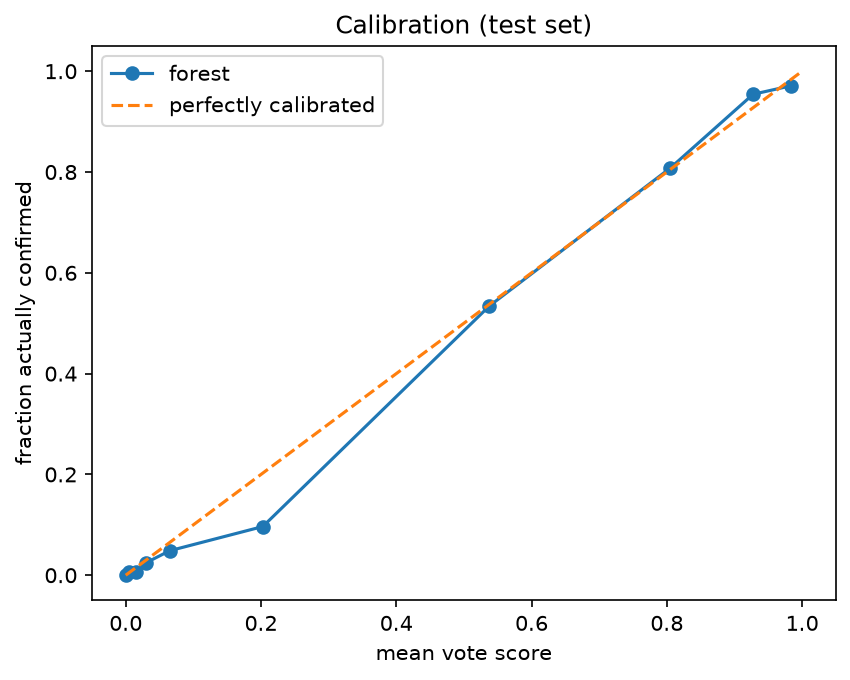
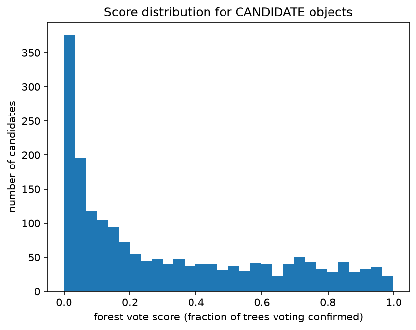

# Kepler Exoplanet Classifier

_Telling confirmed planets from false positives in Kepler data, with leakage-aware features and a star-grouped evaluation._



A random forest trained on nine physical measurements from NASA's Kepler Objects of Interest (KOI) table separates confirmed exoplanets from false positives with an F1 of 0.89 to 0.90 for the confirmed class (depending on the split), compared with 0.76 to 0.78 for a logistic regression baseline. The project goes past a single accuracy number: it checks for label leakage, evaluates by star, measures how performance changes with training size, examines what the model relies on and whether that makes physical sense, tests how trustworthy its scores are, and applies it to the objects Kepler could not resolve.

## Results at a glance

Held-out test set of 1,457 objects (955 false positives, 502 confirmed), split by star:

| Model                                        | Accuracy  | Precision (confirmed) | Recall (confirmed) | F1 (confirmed) |
| -------------------------------------------- | --------- | --------------------- | ------------------ | -------------- |
| Majority-class dummy                         | 0.655     | 0.000                 | 0.000              | 0.000          |
| Logistic regression (baseline)               | 0.831     | 0.713                 | 0.853              | 0.777          |
| Logistic regression (balanced class weights) | 0.814     | 0.667                 | 0.920              | 0.773          |
| **Random forest**                            | **0.927** | **0.876**             | **0.918**          | **0.897**      |

Five-fold cross-validation grouped by star gives a mean F1 of **0.888 ± 0.008** for the random forest and **0.760 ± 0.018** for logistic regression, so the main results are not an accident of one split.

- The 0.655 accuracy of the dummy shows why accuracy alone misleads here: 65.5% of the test set is false positives, so always guessing "false positive" looks decent while finding no planets at all.
- The forest beats logistic regression in every cross-validation fold, mostly through better precision (fewer false alarms) at similar recall.
- On the test set the forest makes 65 false alarms and misses 41 real planets.

## Question and approach

**Question:** can a model tell confirmed exoplanets from false positives using only measured properties of the transit signal and the host star?

1. Pull the KOI cumulative table from the NASA Exoplanet Archive.
2. Label objects `CONFIRMED` (1) or `FALSE POSITIVE` (0). Set aside `CANDIDATE` objects, which have no answer yet, for the end.
3. Use nine features: orbital period, transit duration, transit depth, planet radius, equilibrium temperature, insolation, transit signal-to-noise, stellar temperature and stellar radius.
4. Split train and test by star so no star appears on both sides.
5. Compare a majority-class dummy, a logistic regression baseline (scaled features) and a random forest (300 trees), reporting precision, recall and F1 for the confirmed class.
6. Run experiments on the result: learning curve, feature importance, calibration, decision threshold.
7. Score the candidates and rank them.

## Data

**Source:** the Kepler Objects of Interest cumulative table from the [NASA Exoplanet Archive](https://exoplanetarchive.ipac.caltech.edu), retrieved on October 18, 2026 through the archive's query interface (the exact query is in the notebook). The table has 9,564 objects: 2,748 confirmed, 4,839 false positives and 1,977 candidates.

As a check, a full manual export of the same table (produced by the archive on October 18, 2026) matched the retrieved data row for row (9,564 rows, identical labels), with identical values in all columns the project uses except `koi_depth`, which differs only by rounding (at most 0.005%).

The archive table is updated over time, so rerunning the query later may give slightly different counts. `koi_cumulative.csv` in this repository is the snapshot all results here were computed from.

## Cleaning log

| Step                                         | Rows          |
| -------------------------------------------- | ------------- |
| Labeled objects (confirmed + false positive) | 7,587         |
| Dropped for missing feature values           | 259 (3.4%)    |
| Usable for modeling                          | 7,328         |
| Training set / test set                      | 5,871 / 1,457 |

Class balance among the usable rows: 62.5% false positives, 37.5% confirmed.

All 259 dropped rows were missing the same six measurements (transit depth, planet radius, equilibrium temperature, signal-to-noise, stellar temperature and stellar radius), and 219 were also missing insolation. Orbital period and transit duration were never missing. 257 of the 259 dropped rows were false positives, so missingness is strongly tied to the label.

All 259 have fit type `none` in the archive, which the archive defines as objects where no transit fit is provided and only period, epoch and duration are reported. Of the 264 labeled objects with fit type `none`, 259 (98%) were dropped and 5 had complete features. The archive does not say why these objects have no fit, so I make no claim about the cause.

I dropped rather than imputed to avoid the model learning "missing means false positive," a signal that comes from the vetting pipeline and not from the physics. The same filter removed 104 of the 1,977 candidates, so the final candidate ranking covers only candidates with complete measurements.

## Two decisions that matter

**Leakage.** I excluded `koi_score` and all `koi_fpflag_*` columns because they come from the same vetting process that assigned the labels, so including them would let the model read the answer instead of learning from the measurements. The archive's column definitions describe `koi_score` as a confidence in the disposition and the flags as the reasons an object failed vetting.

**Star split.** I split by star (`kepid`) with `GroupShuffleSplit` so that no star appears in both train and test, which would otherwise inflate the test score. As a check, a random row split gave a forest F1 of 0.886 against 0.897 for the star-grouped split, so I found no evidence that mixing stars inflated the results here. The difference is about the size of the fold-to-fold spread, so I read nothing into which is higher. Grouping by star remains the safer design, since it rules out this kind of leakage by construction.

## Learning curve

Retraining the forest on 10% to 100% of the training set (five random subsets per size, scored on the same test set):

| Training size | Mean F1 | Std   |
| ------------- | ------- | ----- |
| 10%           | 0.852   | 0.015 |
| 25%           | 0.873   | 0.006 |
| 50%           | 0.886   | 0.005 |
| 75%           | 0.887   | 0.005 |
| 100%          | 0.894   | 0.001 |



Most of the gain arrives by 50% of the data. Going from 50% to 100% adds about 0.008, which is comparable to the run-to-run spread, so the curve shows diminishing returns. This suggests more data of the same kind would help only slightly, and that better features or a different model are more likely to help. The small spread at 100% reflects only the forest's own randomness, since every run uses the same rows.

## What the model relies on

The forest relies most on planet radius (`koi_prad`), followed by transit signal-to-noise (`koi_model_snr`), orbital period (`koi_period`) and transit duration (`koi_duration`). These four rank in the same order under impurity-based importance and under permutation importance on the test set. Shuffling radius alone costs about 0.29 F1, more than twice the drop from the next feature. Below the top four the two methods disagree, so only the top four are a robust ranking.




**Does it make sense physically?**

- **Planet radius.** Confirmed planets cluster near 2 Earth radii, while a large share of false positives have radii of tens of Earth radii. This is consistent with false-positive causes the archive lists, such as eclipsing binaries: radius is computed as the planet-star radius ratio times the target star's radius, so it does not represent a real planet size if the eclipse is stellar or on another star. The archive does not state that the large-radius group consists of eclipsing binaries, so I describe this as consistent with that explanation, not proof of it.
- **Signal-to-noise.** Informative, but not as simple as "low means false positive." Confirmed planets concentrate in a moderate range, while false positives peak slightly below it and also have a long tail of very high values where confirmed planets are almost absent. Among false positives, log radius and log signal-to-noise correlate at about 0.72, which is expected because a larger radius ratio produces a deeper transit and a stronger signal. That shows the features move together; it is not independent evidence about what the large-radius objects are.
- **Period and duration.** Confirmed planets form one broad hump in period around roughly 5 to 20 days. False positives pile up at very short periods and form a separate bump at roughly 300 to 500 days. Both classes center near 3 to 4 hours in duration, but false positives have heavier tails at both ends. I did not establish the cause of these patterns.
- **Lower-ranked features** are partly redundant with the top ones (depth is tied to the radius ratio, stellar radius is a direct factor in planet radius, and equilibrium temperature and insolation are derived from stellar properties and orbital distance), so their low importance does not mean they are physically uninformative. Importance shows which features the model uses, not which direction they push a prediction.




## How trustworthy are the scores?

The forest's vote score is the fraction of its 300 trees voting "confirmed." On the labeled test set it is roughly calibrated: objects scoring around 0.5 were confirmed about half the time and objects around 0.8 about 80% of the time, with a modest over-prediction near a score of 0.2. This was measured on labeled objects only, so it may not carry over to the harder candidate population.



**Decision threshold.** I weigh missed planets more heavily than false alarms, so I examined the threshold:

| Threshold | Precision (confirmed) | Recall (confirmed) |
| --------- | --------------------- | ------------------ |
| 0.3       | 0.803                 | 0.952              |
| 0.4       | 0.842                 | 0.936              |
| 0.5       | 0.876                 | 0.918              |
| 0.6       | 0.891                 | 0.876              |
| 0.7       | 0.909                 | 0.797              |

Lowering the threshold from 0.5 to 0.3 raises recall from 0.92 to 0.95 but lowers precision from 0.88 to 0.80. Working back from the rounded values, that recovers roughly 17 more planets at a cost of roughly 50 more false alarms, about three false alarms per additional planet. The right threshold depends on how costly follow-up is relative to a missed discovery, so I report the trade-off instead of a single tuned value. The thresholds were compared on the test set, so these numbers illustrate the trade-off and are not a tuned estimate.

## Ranking the candidates

I applied the final forest to the 1,873 candidates with complete measurements. 91 (4.9%) have a vote score of at least 0.9 and 530 (28.3%) at least 0.5.



There is a large spike near 0, but the remaining scores are spread broadly between about 0.2 and 1.0 instead of piling up near 1, so many candidates are ambiguous to the model. Candidates are the objects the Kepler vetting process could not resolve, so performance on them is likely lower than the test-set results. The top-ranked candidates all have radii between about 1.9 and 4.3 Earth radii. The top three scores tie, so their order within the tie is arbitrary.

The full ranking is in `ranked_candidates.csv` (columns: `kepid`, the nine features and `forest_vote_score`). Some stars have several candidates, so `kepid` repeats; rows can be told apart by orbital period. This is a ranking from a simple model, not a discovery.

## Limitations and next steps

**Limitations.** All results use nine tabular features from the KOI table. The main results come from one star-grouped split, supported by five-fold grouped cross-validation (random forest F1 0.888 ± 0.008). The threshold comparison was done on the test set, so it illustrates a trade-off and is not a tuned estimate. Calibration was measured on labeled objects only, and candidates are the objects vetting could not resolve, so performance on them is likely lower. 104 candidates with missing measurements were excluded from the ranking.

**Next steps**

1. **Analyze where the model fails.** Check whether the false alarms are concentrated among small-radius objects, where both classes overlap, and why candidates receive such broadly spread scores.
2. **Select the decision threshold properly.** Choose it with cross-validation or a separate validation set instead of the test set, using the cost of a missed planet vs a false alarm as the criterion.
3. **Compare imputation with dropping rows.** Train a model with imputed values plus missing-value indicators and compare it to the current approach. Because nearly all dropped rows were false positives, this would show how much a "missing means false positive" shortcut could contribute.
4. **Test on light curves.** Train a 1D CNN on Kepler light curves (for example with `lightkurve`), since the learning curve suggests the nine tabular features, not the amount of data, may be the limit.

## Repository contents

```
kepler-exoplanet-classifier/
├── README.md
├── kepler_exoplanet_classifier.ipynb   # full analysis, run top to bottom
├── requirements.txt                    # pinned package versions
├── koi_cumulative.csv                  # data snapshot (retrieved Oct 18, 2026)
├── ranked_candidates.csv               # ranked candidate objects
└── figures/                            # charts used in this README
```

## How to run

Developed with Python 3.14.6; package versions are pinned in `requirements.txt`.

```bash
pip install -r requirements.txt
jupyter notebook kepler_exoplanet_classifier.ipynb
```

Run all cells from the top. The notebook reads `koi_cumulative.csv` if it is present; if you delete it, the first cell pulls a fresh copy from the archive, and counts may differ slightly if the archive has been updated. One check in the cleaning section (fit type of the dropped rows) queries the archive live and skips itself with a message if the archive cannot be reached.

## Attribution

Data: [NASA Exoplanet Archive](https://exoplanetarchive.ipac.caltech.edu), Kepler Objects of Interest cumulative table. See the archive's website for its recommended citation. This is an independent portfolio project and is not affiliated with or endorsed by NASA.
